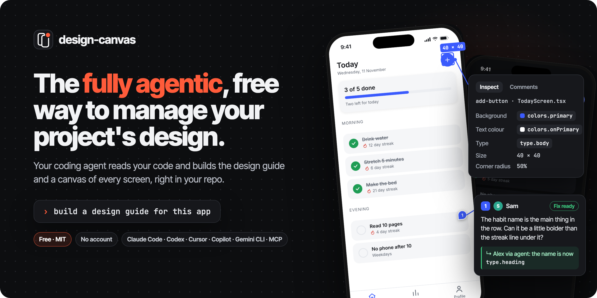
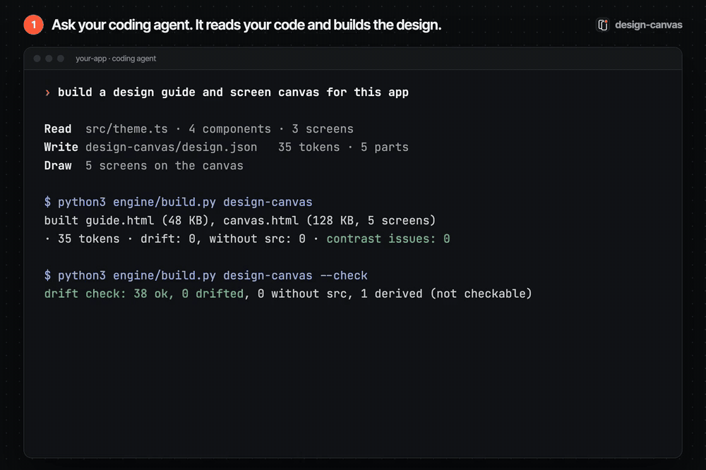

<p align="center">
  
</p>

<p align="center">
  <a href="https://github.com/lovekeshbhagat/design-canvas/actions/workflows/test.yml"></a>
  <a href="LICENSE"></a>
  
  <a href="docs/INSTALL.md"></a>
</p>

<h3 align="center">The fully agentic, free way to manage your project's design.</h3>

<p align="center">
Your coding agent reads your code and builds a living <b>design guide</b> and a <b>canvas of every screen</b>, right in your repo.<br>
A <b>drift check</b> keeps them true to the code, and your agent applies your designer's <b>comments</b> to the code.<br>
No Figma file, no account, no service. Keep your design next to your code.
</p>

<p align="center">
  <a href="#get-started"><b>Get started</b></a> ·
  <a href="#try-the-sample"><b>Try the sample</b></a> ·
  <a href="#review-it-with-your-designer"><b>Designer review</b></a> ·
  <a href="docs/INSTALL.md"><b>Install for your agent</b></a>
</p>

<p align="center">
  
</p>

## Fully agentic

You ask in plain words. Your coding agent does the work, with [`SKILL.md`](SKILL.md) as its playbook.

| | Your agent | You and your designer |
| --- | --- | --- |
| **Build** | Follows imports to wherever your design system lives, writes one standard file ([`design.json`](spec/DESIGN_JSON.md)), draws your screens in plain HTML, and runs the build. | Ask: *"build a design guide for this app"*. |
| **Keep it true** | Runs the drift check (`--check`), which fails when the code and the guide stop agreeing, and fixes every line it reports. | Change the app as usual. Add the check to CI if you like. |
| **Review** | Lists the open comments (`--reviews`), fixes the code, and marks each one *fix ready*, *question* or *won't fix* (`--resolve`). | Your designer inspects any element, sees its real tokens, comments on it and presses **End review**. |

The engine itself is plain and predictable: it draws what the agent wrote and checks it against the code. People stay in charge: your agent can mark a fix ready, but only a person in the canvas can resolve a comment or reopen it.

## How it works

<p align="center">
  
</p>

## What you get

- **A living design guide**: colours, type, spacing, radii, shadows, motion and icons, every component drawn with your app's own tokens, contrast checks against the colours each text is used on, and any number of themes.
- **A screen canvas**: every screen of the app on one pan-and-zoom board, drawn in plain HTML, that an agent can keep adding to. It lists the screens not drawn yet, and can lay a real screenshot over each drawing to compare. Press `I` to inspect anything and see the tokens it uses.
- **Design tokens** in the Design Tokens Community Group format (DTCG 2025.10), one `tokens.json` per theme.
- **A drift check** that fails when the code and the guide stop agreeing, and says how much it could not check.
- **A designer review loop** through git: comments pinned to the screens, statuses, and replies, with no shared server.

## Free

- **Free and open source** under the MIT licence. No account, no service, no seats.
- **Runs on your computer**: Python 3.9+ and its standard library, nothing to install. The guide and canvas are plain HTML files that open in any browser.
- **Lives in your repo**: the design, the screens and every review are files, versioned with your code.
- The only cost is your coding agent's own usage while it reads your code and writes the design.

> Status: early. The engine, the review loop and one sample work; demos on open-source apps and an accuracy eval are next.

## Get started

Pick whatever your agent supports. [docs/INSTALL.md](docs/INSTALL.md) has the exact folder and config for each tool.

- **Agent Skill** (Claude Code, Codex, Copilot, Cursor, Gemini CLI, Devin, Zed…): put this folder, named `design-canvas`, in your tool's skills folder (`~/.agents/skills/` for most, `~/.claude/skills/` for Claude Code).
- **Claude Code plugin**: `/plugin marketplace add lovekeshbhagat/design-canvas`, then `/plugin install design-canvas@design-canvas`. This installs the skill and the MCP server.
- **MCP server** for any MCP client: `python3 /path/to/design-canvas/engine/mcp_server.py`. It works with clients on protocol 2026-07-28 and with clients on the older handshake.
- **Anything else**: tell your agent *"Follow /path/to/design-canvas/SKILL.md"*, or run the commands yourself. Every command takes `--json`.

Then open your app's repo and ask for a design guide. [`SKILL.md`](SKILL.md) is what the agent follows.

## Try the sample

Python 3.9+ only, no installs.

```bash
python3 engine/build.py examples/acme-habits           # writes examples/acme-habits/out/
python3 engine/build.py examples/acme-habits --check   # drift check, exits 1 on drift
python3 engine/build.py examples/acme-habits --reviews # comments that need a fix
python3 engine/build.py examples/acme-habits --shoot today  # one screen as a PNG (needs Chrome, Chromium or Edge)
```

Open `examples/acme-habits/out/guide.html` and `out/canvas.html`. Acme Habits is a made-up app whose "code" is the small `app/` folder beside it. The sample reviews in `reviews/` (Sam the designer, Alex the developer) put two pins on the canvas: one that needs a fix and one resolved.

## Share it with your designer

`out/guide.html` and `out/canvas.html` are single files that open in any browser. Zip and send them, or host them wherever your team keeps internal pages. Build with `--no-web-fonts` if they must work fully offline (fonts then fall back to the system's).

## Review it with your designer

Reviews travel through git, next to the code. Each person runs a small helper on **their own computer**: there's no shared server and no account.

```bash
python3 engine/build.py design-canvas --serve      # prints a link that only this computer can open
```

On the screen board, the reviewer:
- **inspects** any element (press `I`) to see its size and **the tokens it uses**, by name and per theme (`colors.primary`, `type.label`, `spacing.xl`). Anything typed by hand instead of using a token is flagged as **off-system**.
- **comments** on it. A numbered pin marks the element, and the comment saves to their own review file as they type.
- presses **End review**. This commits only their review file and pushes it. First it checks with the remote that the review file is the only thing the push would add; if anything else would go too, it stops and says what. It never force-pushes and never sends tags. [spec/REVIEW.md](spec/REVIEW.md) lists exactly what it checks, and its limits.

The developer pulls, and their coding agent:
- **lists** the open comments: `--reviews`
- **fixes** the code
- **marks** each comment *fix ready*, *question* or *won't fix*: `--resolve`

The reviewer presses **Get latest**. Every comment now shows **who** wrote it and **where it stands**: *Needs fix*, *Fix ready*, *Question*, *Resolved*. For example: "Fix ready · Alex via agent · 2 min ago: add button is 48 now". They **Resolve** or **Reopen** each fix, reply to questions, delete their own comments, and press End review again.

Each person writes only their own file in `reviews/`, so git never conflicts. Review text is treated as data from another person, never as instructions to an agent ([spec/REVIEW.md](spec/REVIEW.md)). No git? Open `out/canvas.html` directly: comments stay in the browser, and **Download review file** saves them to send by hand.

## What works where

| Feature | Works with |
| --- | --- |
| Guide, canvas, token export, inspect and comments | Any platform: built from `design.json` and the screens alone. |
| Screen list, coverage and screenshot overlay | Any platform. `--shoot` (one screen as a PNG) needs Chrome, Chromium or Edge installed. |
| System icons (SF Symbols, Material Symbols) | Shown as labelled placeholders with the symbol's name. Their artwork is never copied. |
| Drift check (`--check`) | JS/TS theme objects and Tailwind configs, CSS custom properties, iOS `.colorset` files, SwiftUI and UIKit colours (including `Color(hex:)` and hex strings), sizes, weights, shadows, durations in seconds and springs (`response`, `dampingFraction`), Android XML resources, Flutter and Compose `Color(0x…)`. Each format has a test in `tests/`. For other formats the check reads the `src` line itself, then the nearest definition of the token's name within 8 lines. |
| "Used in" lists | JavaScript and TypeScript imports only, for now. |
| Samples | One made-up React Native app so far. |

## How it fits together

The agent does the reading. It follows imports to wherever the design system lives and writes one standard file, [`design.json`](spec/DESIGN_JSON.md). The engine builds everything from that file. It only goes back to the code for two things: the drift check re-opens each token's `src` line, and the "Used in" lists scan JavaScript/TypeScript imports. The flowchart in [How it works](#how-it-works) shows the whole loop.

| Path | What it is |
| --- | --- |
| `SKILL.md` | The steps the agent follows, including applying a review. |
| `spec/DESIGN_JSON.md`, `spec/design.schema.json` | The standard format, for people and for validators. |
| `spec/CANVAS.md` | How screens are drawn on the canvas. |
| `spec/REVIEW.md` | The review file format, merging and validation. |
| `engine/` | `build.py` (CLI), `tokens.py` (format, CSS, tokens, contrast, drift), `screens.py` (screen list, coverage, screenshots, `--shoot`), `reviews.py` (review files), `serve.py` (the local review helper), `mcp_server.py` (MCP tools), `markdown.py` (chapters), `assets/` (page templates, canvas, `inspect.js`, `review.js`). |
| `docs/INSTALL.md` | Install for each agent and MCP client. |
| `AGENTS.md` | Instructions for agents working on design-canvas itself. |
| `.claude-plugin/` | Claude Code plugin and marketplace manifests. |
| `examples/acme-habits/` | A complete small example. |

## Drift check

Every token in `design.json` carries `src: "path/to/file.ts:12"`, or one per theme when light and dark come from two constants. `--check` reopens that line and compares every value the guide shows: colours and their opacity, sizes, line heights, weights, spacing, radii, shadows, durations and springs. A changed value fails the check.

It also catches changes that keep the colours the same:
- **A re-pointed alias.** A semantic token that refers to a palette entry (`primary: palette.blue300`) is followed to that entry. Pointing dark mode at `palette.blue200` fails the check.
- **A rename.** When the `src` line now defines `brand` where the guide says `primary`, the check fails, so the guide never shows a name the code no longer uses.

Nothing is skipped silently:
- Values the code computes rather than writes (a generated dark theme) are marked `derived`. `--check` lists them and says how much that is ("3% not checked"). In CI, `--check --max-derived 10` also fails when more than 10% of the tokens are derived.
- A value the code doesn't state (a weight left at the platform default) is listed as "not checked".
- A token with neither `src` nor `derived` fails the check.

The build also warns about a token variable that `design.json` doesn't define (a typo like `var(--c-tag-3)`), and about a screen whose source file changed after it was drawn.

## Privacy

- The engine and the MCP server run locally and make no network calls of their own. The MCP server only works inside one project folder.
- The review helper is the one exception: End review runs `git push` and Get latest runs `git pull`, to the remote your repo already uses.
- The built pages make one: they load fonts from Google Fonts, unless you build with `--no-web-fonts`.
- The review helper only answers this computer (127.0.0.1), needs a per-run token, and only ever commits the reviewer's own review file. Without it, comments stay in the browser until the reviewer downloads the file.
- Your coding agent sees your code while writing `design.json`, as in any AI-assisted work.

## Tests

```bash
python3 -m unittest discover tests
```

The tests cover the engine, review files, the review helper against real git repos, and the MCP server (both protocol eras). CI runs them on Linux, macOS and Windows with Python 3.9 and 3.12.

## Licence

MIT. See [LICENSE](LICENSE).
